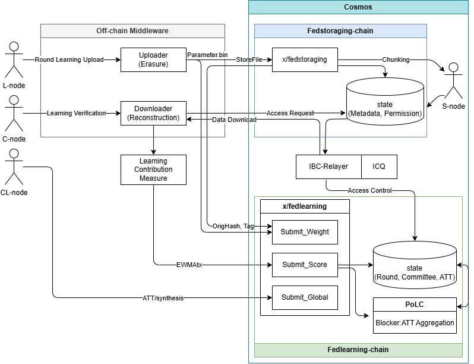

## Environment
Ignite CLI version:             v29.3.1-dev
Ignite CLI source hash:         845a1a8886b8a098ed56372bab45ddee5caea526
Ignite CLI config version:      v1
Cosmos SDK version:             v0.53.3
Your go version:                go version go1.24.7 linux/amd64

# flmainchain

연합학습(Federated Learning) **기여도 평가 기반 블록체인**의 **메인체인(Layer 1)** 입니다.
Cosmos SDK + Ignite CLI로 만들었으며, 연합학습 라운드의 진행 상태, L-node의 학습 결과 해시, C-node의 기여도 점수, 최종 기여도표(ATT), 다음 라운드 위원회, 글로벌 모델 해시를 온체인에 기록합니다.

> 서비스 배포용이 아니라 **논문 실험 환경 구축**을 목표로 하는 연구용 프로젝트입니다.

## 프로젝트 구성

이 프로젝트는 역할별로 3개의 레포지토리로 나뉘어 있습니다.

| 레포지토리 | 역할 | 주요 모듈/구성 |
|---|---|---|
| **[flmainchain](https://github.com/skg4463/flmainchain)** (이 레포) | 메인체인. 라운드·위원회·기여도(ATT)·글로벌 모델 해시 관리 | `x/fedlearning` |
| [flstorage](https://github.com/skg4463/flstorage) | 사이드체인. 학습 결과 원본(가중치 파일)의 메타데이터·샤드 해시 저장 | `x/fedstoraging` |
| [fls-client](https://github.com/skg4463/fls-client) | 오프체인 클라이언트(업로더/다운로더), 자동 시뮬레이션·성능 측정 스크립트 | `uploader/`, `downloader/`, `simulate_auto.sh` |



(다이어그램 원본: `diagram.drawio`, `diagram.svg`, Mermaid 버전 `diagram.md`)

## 노드 역할

| 노드 | 설명 |
|---|---|
| **L-node** (학습 노드) | 로컬 학습을 수행하고, 학습 결과(weight `.bin`)를 사이드체인에 저장한 뒤 메인체인에 `originalHash`와 `tag`를 제출 |
| **C-node** (위원회) | 라운드마다 교체되는 위원회. 이번 라운드에 제출된 L-node 학습 결과를 사이드체인에서 가져와 각 L-node의 기여도 점수를 계산·제출 |
| **CL-node** (위원회 리더) | 위원회 명단의 첫 번째 멤버. 집계된 ATT를 바탕으로 글로벌 모델을 만들고 그 해시를 제출하며, 이 제출이 다음 라운드 위원회 선출을 트리거 |

## 라운드 진행 방식

한 라운드는 상태(`Round.status`)가 아래 순서로 바뀌며 진행됩니다. 상태 전이는 **블록 높이가 아니라 제출 완료 여부**로 결정되며, 매 블록의 `BeginBlock`(`AdvanceRoundState`)에서 검사합니다.

```
init-round (최초 1회)
      │
      ▼
WeightSubmissionOpen ── 모든 required L-node가 submit-weight ──► (다음 블록 BeginBlock)
      │
      ▼
ScoreSubmissionOpen ─── 모든 required C-node가 submit-score ──► (다음 블록 BeginBlock)
      │
      ▼
AggregationReady ────── 같은 BeginBlock에서 AggregateScoresAndCreateATT 실행
      │
      ▼
AggregationComplete ─── CL-node가 submit-global-model
      │                  └─► ElectNextCommittee: 다음 라운드 생성, CurrentRound + 1
      ▼
(다음 라운드) WeightSubmissionOpen ...
```

- **ATT 집계** (`AggregateScoresAndCreateATT`): 해당 라운드의 모든 `SubmittedScore`를 모아 L-node별 **점수 평균(정수)** 을 내고, 높은 순으로 정렬해 `FinalAtt`에 저장합니다.
- **위원회 선출** (`ElectNextCommittee`): ATT 상위 5명을 다음 라운드 C-node로, 그중 1위(`members[0]`)를 CL-node로 지정합니다. L-node 명단(`required_l_nodes`)은 이전 라운드를 그대로 이어받습니다.
- 집계/선출 함수는 실행 시간을 `PERF Done` 로그로 남기며, [fls-client](https://github.com/skg4463/fls-client)의 `script/plot_onchain.py`가 이 로그를 분석합니다.

## `x/fedlearning` 모듈

### 트랜잭션

| 명령 | 서명자 | 설명 |
|---|---|---|
| `init-round [l-nodes] [c-nodes]` | 아무나 (최초 1회) | 1라운드 생성. 쉼표로 구분한 L-node 주소 목록, 초기 C-node 주소 목록 (첫 번째가 CL-node) |
| `submit-weight [round-id] [original-hash] [tag]` | required L-node | 학습 결과 해시·태그 제출 (`WeightSubmissionOpen`에서만) |
| `submit-score [round-id] [lnode-addrs] [scores]` | required C-node | L-node 주소 목록과 같은 순서의 점수 목록 제출 (`ScoreSubmissionOpen`에서만) |
| `submit-global-model [round-id] [original-hash]` | CL-node | 글로벌 모델 해시 저장 + 다음 위원회 선출 |

`create/update/delete-current-round`는 Ignite 스캐폴딩으로 생성된 디버그용 메시지입니다.

### 쿼리 / 상태

모든 맵 타입은 `list-*`, `show-*`(= `get-*`) 쿼리를 가집니다.

| 상태 | 키 | 내용 | 쿼리 예 |
|---|---|---|---|
| `CurrentRound` | (단일 값) | 현재 라운드 번호 | `show-current-round` |
| `Round` | round id | 상태, required/submitted L-node·C-node 목록 | `show-round 1` |
| `RoundCommittee` | round id | 해당 라운드 위원회 (`members[0]` = CL-node) | `show-round-committee 2` |
| `ModelSubmission` | original hash | L-node가 제출한 tag, 제출자 | `show-model-submission <hash>` |
| `SubmittedScore` | `"{round}-{c-node주소}"` | C-node가 제출한 점수 목록 | `list-submitted-score` |
| `FinalAtt` | round id | 집계된 최종 기여도표 (점수 내림차순) | `show-final-att 1` |
| `GlobalModel` | round id | 글로벌 모델 해시 | `show-global-model 1` |

### IBC

- 포트 `fedlearning`, 채널 버전 `fedlearning-1`
- 사이드체인 `flstorage`의 `fedstoraging` 포트와 채널을 연결합니다. (패킷 타입은 아직 정의되어 있지 않음 → [구현 현황](#구현-현황--한계) 참고)

## 개발 환경

| 항목 | 버전 |
|---|---|
| Ignite CLI | v29.3.1-dev |
| Cosmos SDK | v0.53.3 |
| ibc-go | v10 |
| Go | 1.24.7 |
| Hermes (relayer) | v1.13.1 (Ignite Hermes 앱) |

- 바이너리: `flmainchaind`, 체인 ID: `flmainchain`
- 주소 prefix: `fls` (사이드체인과 동일)

## 실행

### 1. 체인 실행

```bash
ignite chain serve
```

사이드체인(`flstorage`)과 같은 머신에서 띄울 수 있도록 포트를 기본값과 다르게 설정해 두었습니다 (`config.yml`).

| 용도 | flmainchain | (참고) flstorage |
|---|---|---|
| CometBFT RPC | **26658** | 26657 |
| REST API | **1318** | 1317 |
| gRPC | **9091** | 9090 |
| Faucet | **4501** | 4500 |

따라서 메인체인에 CLI 명령을 보낼 때는 항상 `--node tcp://localhost:26658`을 붙입니다.

```bash
flmainchaind query bank balances <ADDRESS> --node tcp://localhost:26658
```

`config.yml`에는 `alice`, `bob`, `node0`~`node9` 계정이 니모닉과 함께 정의되어 있습니다. 사이드체인도 **같은 니모닉과 같은 `fls` prefix**를 쓰므로, 같은 키 이름은 두 체인에서 같은 주소를 가집니다. (사이드체인 접근제어에서 메인체인 위원회 주소를 그대로 사용할 수 있는 이유)

| 이름 | 주소 |
|---|---|
| alice | `fls1nmfejs8r6mt584lm4h00470szx9q4g8ed4un7r` |
| bob | `fls10twpnm0ecc970u4wsu5z0g65mq5qddxc0qxz83` |
| node0 ~ node9 | `relayer setting manual.txt` 참고 |

### 2. IBC 릴레이어(Hermes) 설정

> 라운드 시뮬레이션(`fls-client/simulate_auto.sh`) 자체는 IBC를 사용하지 않습니다. 채널 연결 확인이나 ICQ 기반 접근제어 실험에만 필요합니다.

두 체인을 모두 실행한 상태에서 진행합니다. Hermes 설정 파일은 Ignite Hermes 앱으로 생성한 `~/.ignite/relayer/hermes/flmainchain_flstorage`를 사용합니다.

```bash
HERMES_APP=~/.ignite/apps/hermes/bin/v1.13.1
CONFIG_PATH=~/.ignite/relayer/hermes/flmainchain_flstorage
```

**① 릴레이어 키 등록** — 두 체인에 같은 니모닉으로 등록합니다. (아래는 테스트용 니모닉)

```bash
echo "abandon abandon abandon abandon abandon abandon abandon abandon abandon abandon abandon abandon abandon abandon abandon abandon abandon abandon abandon abandon abandon abandon abandon art" \
  | $HERMES_APP --config $CONFIG_PATH keys add --chain flmainchain --mnemonic-file /dev/stdin
```

```bash
echo "abandon abandon abandon abandon abandon abandon abandon abandon abandon abandon abandon abandon abandon abandon abandon abandon abandon abandon abandon abandon abandon abandon abandon art" \
  | $HERMES_APP --config $CONFIG_PATH keys add --chain flstorage --mnemonic-file /dev/stdin
```

```bash
$HERMES_APP --config $CONFIG_PATH keys list --chain flmainchain
```

→ 릴레이어 주소: `fls1r5v5srda7xfth3hn2s26txvrcrntldjuqs34tt`

**② 릴레이어 계정에 수수료용 토큰 지급** (각 체인 faucet)

```bash
curl -X POST -d '{"address": "fls1r5v5srda7xfth3hn2s26txvrcrntldjuqs34tt", "coins": ["10000000stake"]}' http://localhost:4501/credit
```

```bash
curl -X POST -d '{"address": "fls1r5v5srda7xfth3hn2s26txvrcrntldjuqs34tt", "coins": ["10000000stake"]}' http://localhost:4500/credit
```

**③ 채널 생성 및 릴레이어 시작**

```bash
$HERMES_APP --config $CONFIG_PATH create channel \
  --a-chain flmainchain --b-chain flstorage \
  --a-port fedlearning --b-port fedstoraging \
  --new-client-connection --channel-version fedlearning-1
```

```bash
$HERMES_APP --config $CONFIG_PATH start
```

### 3. 라운드 수동 실행 예시

전체 라운드를 자동으로 돌리려면 [fls-client](https://github.com/skg4463/fls-client)의 `simulate_auto.sh`를 사용하세요. 아래는 한 라운드를 손으로 진행하는 예시입니다.

**① 1라운드 초기화** — L-node 10개(node0~9), 초기 C-node 5개(node0~4, CL-node = node0)

```bash
ALL_MEMBERS=$(for i in {0..9}; do flmainchaind keys show node$i -a; done | paste -sd,)
INITIAL_C_NODES=$(for i in {0..4}; do flmainchaind keys show node$i -a; done | paste -sd,)
flmainchaind tx fedlearning init-round "$ALL_MEMBERS" "$INITIAL_C_NODES" --from node0 --node tcp://localhost:26658 -y
```

```bash
flmainchaind query fedlearning show-current-round --node tcp://localhost:26658
```

```bash
flmainchaind query fedlearning show-round 1 --node tcp://localhost:26658
```

**② L-node: 학습 결과 제출** — 먼저 fls-client `uploader`로 사이드체인에 파일을 올리고, 출력된 `originalHash`를 제출합니다. (모든 required L-node가 제출해야 다음 단계로 넘어감)

```bash
flmainchaind tx fedlearning submit-weight 1 <originalHash> "1-node0-flstorage" --from node0 --node tcp://localhost:26658 -y
```

**③ C-node: 기여도 점수 제출** — L-node 주소 목록과 점수 목록을 같은 순서로 쉼표 구분하여 제출합니다.

```bash
flmainchaind tx fedlearning submit-score 1 "<lnode1>,<lnode2>,..." "85,78,..." --from node1 --node tcp://localhost:26658 -y
```

**④ ATT 확인** — 모든 C-node가 제출하면 다음 블록에서 자동 집계됩니다.

```bash
flmainchaind query fedlearning show-final-att 1 --node tcp://localhost:26658
```

**⑤ CL-node: 글로벌 모델 해시 제출 → 다음 위원회 선출**

```bash
flmainchaind tx fedlearning submit-global-model 1 <globalModelHash> --from node0 --node tcp://localhost:26658 -y
```

```bash
flmainchaind query fedlearning show-round-committee 2 --node tcp://localhost:26658
```

```bash
flmainchaind query fedlearning show-global-model 1 --node tcp://localhost:26658
```

## 디렉터리 구조

```
flmainchain/
├── app/                       # 앱 구성, IBC 라우터 등록 (app/ibc.go)
├── cmd/flmainchaind/          # 노드 바이너리
├── proto/flmainchain/fedlearning/v1/   # 메시지·상태 정의
├── x/fedlearning/
│   ├── keeper/round_logic.go  # 라운드 상태 전이, ATT 집계, 위원회 선출
│   ├── keeper/msg_server_*.go # 트랜잭션 처리
│   └── module/                # BeginBlock 훅, AutoCLI, IBC 모듈
├── config.yml                 # Ignite 체인 설정 (계정, 포트)
├── relayer setting manual.txt # 릴레이어 설정 및 수동 실행 메모
└── diagram.*                  # 아키텍처 다이어그램
```

## 구현 현황 / 한계

연구용 프로토타입이므로 설계와 다르거나 단순화된 부분이 있습니다.

- **기여도 집계**: 현재는 C-node 점수의 단순 정수 평균입니다. (EWMA 기반 집계는 미구현)
- **블록-라운드 매핑**: 고정된 "3블록 = 1라운드"가 아니라, 제출 완료 시점에 다음 블록의 BeginBlock에서 상태가 넘어갑니다. `EndBlock`의 높이 기반 로직과 `x/fedlearning/abci.go`는 사용하지 않습니다.
- **합의 참여자**: 위원회 명단은 상태에 기록만 하며, 실제 블록 생성/합의 검증자 집합은 `config.yml`의 validator로 고정되어 있습니다.
- **글로벌 모델**: FedAvg는 체인 밖에서 수행한다고 가정하며, 체인에는 해시만 저장합니다. (시뮬레이션에서는 더미 파일 사용)
- `submit-global-model`은 라운드 상태를 직접 검사하지 않습니다. 상태가 `AggregationComplete`가 아니면 해시만 저장되고 위원회 선출은 일어나지 않습니다.
- **IBC/ICQ**: 채널은 연결되지만 패킷 타입(`FedlearningPacketData`)은 `NoData`뿐이며, 사이드체인의 접근 권한 요청에 응답하는 ICQ 로직은 아직 없습니다.

## 참고

- [Ignite CLI docs](https://docs.ignite.com)
- [Cosmos SDK docs](https://docs.cosmos.network)
- [Hermes relayer](https://hermes.informal.systems)


## Get started

```
ignite chain serve
```

`serve` command installs dependencies, builds, initializes, and starts your blockchain in development.

Port info: 
    tendermint node(RPC): 26658,
    blockchain API: 1318,
    token faucet 4501,
    gPRC: 9091

```
query options: 


flmainchaind query bank balances ADDRESS --node tcp://localhost:26658
```


Relayer setting & hermes setting
```
⦁	잔액 쿼리
flmainchaind query bank balances fls1ppkrhzyg6pf2gg7xxhyq8z8jcclgrn5j3kr765 
flstoraged query bank balances fls1ppkrhzyg6pf2gg7xxhyq8z8jcclgrn5j3kr765  --node tcp://localhost:26658

1. 니모닉으로 각 체인에 계정 추가 (/.hermes/keys/flmainchain/keyring-test/relayer-flmainchain.json)
HERMES_APP=~/.ignite/apps/hermes/bin/v1.13.1
CONFIG_PATH=~/.ignite/relayer/hermes/flmainchain_flstorage

abandon abandon abandon abandon abandon abandon abandon abandon abandon abandon abandon abandon abandon abandon abandon abandon abandon abandon abandon abandon abandon abandon abandon art

$HERMES_APP --config $CONFIG_PATH keys add --chain flmainchain --mnemonic-file /dev/stdin
$HERMES_APP --config $CONFIG_PATH keys add --chain flstorage --mnemonic-file /dev/stdin


2. 생성된 계정 확인 
$HERMES_APP --config $CONFIG_PATH keys list --chain flmainchain
$HERMES_APP --config $CONFIG_PATH keys list --chain flstorage

3. 각 계정에 자금 채우기 
curl -X POST -d '{"address": "fls1r5v5srda7xfth3hn2s26txvrcrntldjuqs34tt", "coins": ["10000000stake"]}' http://localhost:4501/credit
curl -X POST -d '{"address": "fls1r5v5srda7xfth3hn2s26txvrcrntldjuqs34tt", "coins": ["10000000stake"]}' http://localhost:4500/credit

4. 릴레이어 및 헤르메스 시작
$HERMES_APP --config $CONFIG_PATH create channel --a-chain flmainchain --b-chain flstorage --a-port fedlearning --b-port fedstoraging --new-client-connection --channel-version fedlearning-1

$HERMES_APP --config $CONFIG_PATH start

5.1  1라운드 초기화
MEMBERS=$(flmainchaind keys show alice -a),$(flmainchaind keys show bob -a)
echo $MEMBERS

5.2 init-round 트잭 전송
# [MEMBERS 변수]를 사용하여 alice와 bob을 1라운드의 초기 위원으로 설정
flmainchaind tx fedlearning init-round "$MEMBERS" --from alice --node tcp://localhost:26658 -y
-> 확인
flmainchaind query fedlearning show-current-round --node tcp://localhost:26658
flmainchaind query fedlearning show-round 1 --node tcp://localhost:26658
